# PawPal+ with an AI planning assistant

PawPal+ is a Streamlit app that helps a busy pet owner plan their pets' care. It started as the
Module 2 scheduler (priorities, fixed times, conflicts, recurring tasks). This version adds an
**AI planning assistant**: describe your pets and your day in plain English, and an agent looks up
pet-care guidelines, creates the tasks, runs the scheduler to check its own work, fixes what it
finds, and hands you a draft to accept or discard.

AI features (details in the AI planning assistant section below):

- **Agentic workflow:** Claude plans, acts through tools that call the scheduler, and checks its work.
- **Retrieval-augmented generation (RAG):** tasks are based on, and cite, sections of a pet-care knowledge base.
- **Reliability and testing:** guardrails, logging, offline tests of the agent loop, and an eval harness.

## Scenario

A busy pet owner needs help staying consistent with pet care. They want an assistant that can:

- Track pet care tasks (walks, feeding, meds, enrichment, grooming, etc.)
- Consider constraints (time available, priority, owner preferences)
- Produce a daily plan and explain why it chose that plan

Your job is to design the system first (UML), then implement the logic in Python, then connect it to the Streamlit UI.

## What you will build

Your final app should:

- Let a user enter basic owner + pet info
- Let a user add/edit tasks (duration + priority at minimum)
- Generate a daily schedule/plan based on constraints and priorities
- Display the plan clearly (and ideally explain the reasoning)
- Include tests for the most important scheduling behaviors

## Getting started

### Setup

You need Python 3.10 or newer (developed on 3.13) and, for the AI assistant, an
[Anthropic API key](https://console.anthropic.com/).

1. Create a virtual environment and install the dependencies:

   ```bash
   python -m venv .venv
   source .venv/bin/activate  # Windows: .venv\Scripts\activate
   pip install -r requirements.txt
   ```

   On Windows, if `python` is not found, use `py` instead (`py -m venv .venv`).

2. Add your API key. Copy `.env.example` to `.env` and replace the placeholder:

   ```bash
   cp .env.example .env   # Windows: copy .env.example .env
   ```

   `.env` is git-ignored. Without a key the app still runs; only the AI assistant is disabled.

3. Run the app:

   ```bash
   streamlit run app.py
   ```

4. Run the tests (no API key or network needed; the agent tests use a fake Claude client):

   ```bash
   python -m pytest
   ```

5. Optional: run the reliability evals against the real model (uses API tokens):

   ```bash
   python -m evals.run_evals
   ```

### Suggested workflow

1. Read the scenario carefully and identify requirements and edge cases.
2. Draft a UML diagram (classes, attributes, methods, relationships).
3. Convert UML into Python class stubs (no logic yet).
4. Implement scheduling logic in small increments.
5. Add tests to verify key behaviors.
6. Connect your logic to the Streamlit UI in `app.py`.
7. Refine UML so it matches what you actually built.

## 🤖 AI planning assistant

### What it does

In the **Plan with AI** section of the app, the owner types something like:

> I have a 2-year-old husky named Mochi and an adult cat named Luna. I work 9 to 5.
> Mochi takes a pill at 08:00 and 20:00.

The assistant adds Mochi and Luna, creates walks, meals and the two medication doses with
durations and priorities taken from the care guidelines, checks the schedule for clashes, and shows:

- a short summary of what it did and why, citing guideline ids such as `[dogs.md#walks-and-exercise]`
- the list of changes (new pets, new or changed tasks)
- any remaining warnings, the proposed timeline, and the guideline sections it used
- **Accept changes** and **Discard** buttons. Nothing is saved until the owner accepts.
- an **Agent log** with every retrieval, tool call, self-check round and token count.

### How it works



Mermaid source: [diagrams/architecture.mmd](diagrams/architecture.mmd). The diagram reads top
to bottom: **input** (the owner's request or the manual forms), **process** (guardrails,
retriever, agent, validated tools, scheduler, self-check) and **output** (the draft for human
review, then the saved schedule). Results are checked in three places: the automatic self-check
inside the agent loop, the owner's Accept/Discard review, and the tester (pytest) and evaluator
(`evals/run_evals.py`) shown in the Testing and monitoring box.

1. **Retrieve** ([pawpal_rag.py](pawpal_rag.py)). The knowledge base is the markdown files in
   [knowledge/](knowledge/), one chunk per `##` section, each with an id like `cats.md#feeding`.
   Before calling the model, the agent works out which species the request is about (from
   existing pets and words like "husky" or "kitten") and retrieves the top sections with BM25
   keyword scoring. They are put in the prompt inside `<care_guidelines>`. The agent can also
   search again with the `search_care_guidelines` tool.
2. **Plan and act** ([pawpal_agent.py](pawpal_agent.py)). Claude (`claude-opus-5-5` by default)
   gets tools that wrap the existing scheduler: `add_pet`, `add_task`, `update_task`,
   `remove_task`, `set_availability`, `get_current_state`, `build_plan`, `find_free_slot`.
   `add_task` requires a `sources` list, and every id must exist in the knowledge base, so the
   retrieved guidelines decide durations, priorities and frequencies and are recorded in the
   task notes. All changes go to a deep copy of the owner, never the real one.
3. **Check its own work.** When Claude says it is done, the real `Scheduler.build_plan` runs on
   the draft and `check_plan()` looks for conflicts and high-priority tasks that did not fit.
   If there are any, they are sent back to Claude to fix (up to 2 rounds). Pets with no meal
   and medication without a fixed time are reported as warnings.
4. **Human review.** The app shows the draft and its diff; the owner accepts or discards it.
   If the owner edits tasks while a draft is open, Accept is disabled so the draft cannot
   overwrite newer changes.

### Guardrails and logging

| Guardrail | Where |
|---|---|
| Empty requests and requests over 2,000 characters are rejected before any API call | `PawPalAgent.run` |
| At most 20 model calls, 40 tool calls, 25 new tasks and 10 pets per request | constants at the top of `pawpal_agent.py` |
| Every tool input is validated (times, durations 1-240, enum values, pet names, guideline ids); bad input goes back to Claude as an error instead of crashing | `PlanningTools` |
| The agent can only remove tasks it created in the same request, never the owner's | `tool_remove_task` |
| Medication only as the owner describes it, no doses; signs of illness are referred to a vet | system prompt, checked by the evals |
| API errors (bad key, rate limit, network, unknown model) become a readable message; the owner's data is untouched | `_call_model` |
| Refusals are reported, and the request uses the API's server-side model fallback | `_call_model`, `run` |
| Changes are only saved after the owner accepts them | `app.py` |

Every run gets a short id, and each step (retrieval, model call, tool call, tool error, self-check,
guardrail, error, totals) is written to `logs/pawpal_agent.log` (git-ignored, rotating) and shown in
the app's Agent log.

### Configuration

Set in `.env` or the environment:

| Variable | Default | Purpose |
|---|---|---|
| `ANTHROPIC_API_KEY` | (required for AI) | Your Anthropic API key |
| `PAWPAL_MODEL` | `claude-opus-5-5` | Claude model the agent uses |
| `PAWPAL_EFFORT` | `medium` | Reasoning effort (`low`, `medium`, `high`) |

### Testing the AI features

- `tests/test_agent.py` runs the full agent loop against a scripted fake client
  ([tests/fake_claude.py](tests/fake_claude.py)): drafts never touch the original, retrieved
  guidelines reach the prompt, the self-check sends conflicts back and stops after 2 rounds,
  invalid tool input becomes an error result, owner tasks cannot be removed, call limits stop
  runaway loops, API errors and refusals are handled, and every step is logged.
- `tests/test_app_ui.py` drives the real Streamlit app headlessly with the fake client: the
  assistant is disabled without a key, a draft is shown without touching saved data, Accept
  saves it, Discard drops it, and an API error is shown instead of crashing the app.
- `tests/test_rag.py` checks chunking, ranking for typical owner wording, species filtering
  and determinism.
- `evals/run_evals.py` runs the scenarios in [evals/scenarios.json](evals/scenarios.json) against
  the real model and scores the final draft with deterministic checks: expected pets and tasks,
  medication at the right times, no conflicts, high-priority tasks scheduled, guidelines cited,
  owner tasks kept (including a prompt-injection request), no medication invented, and a vet
  referral for a sick pet. `--runs 3` repeats each scenario and reports whether the runs produced
  the same tasks. Results are saved to `evals/results/`.

## 🛠️ Implementation Summary

The scheduling logic is in `pawpal_system.py` and has no Streamlit code, so it can be run and tested on its own (`python main.py`). The Streamlit UI in `app.py` calls it directly: run `streamlit run app.py`.

How the classes work together:

- **`Owner`** holds the owner's available time window and a list of **`Pet`**s. `get_all_tasks()` and `all_tasks_due(day)` return every pet's tasks as one pool of `(pet, task)` pairs, because the owner is a single person.
- **`Pet`** holds its own list of **`Task`**s. Tasks and pets have unique ids, so two with the same name never get mixed up.
- **`Task`** is one care activity: title, duration, priority, and optional category, fixed time, and frequency (once, daily, weekly). It validates itself, knows whether it is due on a given day, and tracks completion.
- **`Scheduler.build_plan(owner, day)`** reads tasks only through `owner.all_tasks_due(day)`, so tasks from all pets are scheduled together and never overlap. It:
  1. Places fixed-time tasks first, at their time, whatever their priority. Overlaps are reported as conflicts and nothing is dropped.
  2. Finds the free gaps in the owner's window.
  3. Fills the gaps with the remaining tasks by priority, then shorter duration, into the first gap that fits.
  4. Lists tasks that don't fit as unscheduled, with a reason.
- **`Plan`** is the result: scheduled entries (task, pet, start, end, reason), unscheduled entries, and conflicts. The UI or `main.py` only reads the plan.

## 🖥️ Sample Output

Output from running `python main.py`:

```
Today's Schedule (Thursday, October 15) for Jordan
----------------------------------------------------
07:00-07:15  Luna   Brushing       [low priority, first gap that fits]
08:00-08:30  Mochi  Morning walk   [fixed time 08:00]
12:30-12:35  Mochi  Medication     [fixed time 12:30]
18:00-18:10  Luna   Dinner         [fixed time 18:00]
```

## 🧪 Testing PawPal+

Run the full suite from the project root (with the virtual environment active):

```bash
python -m pytest          # add -v to list every test
```

The scheduler tests are in `tests/test_pawpal.py` and exercise `pawpal_system.py` directly, with no Streamlit involved. The AI tests (`tests/test_agent.py`, `tests/test_rag.py`, `tests/test_evals.py`, `tests/test_app_ui.py`) are described in [Testing the AI features](#testing-the-ai-features) and need no API key. The scheduler tests cover:

- **Sorting:** `sort_by_time` returns tasks in clock order with untimed tasks last. Built plans list entries chronologically, and flexible tasks are placed by priority.
- **Recurring tasks:** Completing a daily task creates one due the next day, and a weekly task renews on its next weekday. Once tasks don't renew, completing twice doesn't create a duplicate, and `Scheduler.mark_complete` adds the new task to the right pet.
- **Conflict detection:** Overlapping fixed-time tasks are flagged with a suggested free slot, and tasks at the exact same time are flagged for the same pet and across pets. Same-pet overlaps are marked as likely duplicates, and back-to-back tasks are not conflicts.
- **Edge cases:**
  - An owner with no pets, or a pet with no tasks, gives an empty plan.
  - A fixed task outside the availability window is unscheduled.
  - A task exactly as long as the window fits, and one a minute longer does not.
- **Validation:**
  - Empty titles, non-positive durations and weekly tasks without a weekday are rejected.
  - A failed `Task.update` restores the old values.
  - An availability window that ends before it starts is rejected.
- **Filtering:** Tasks can be filtered by pet name (case-insensitive) and by done or pending status.

Output of a successful run of `python -m pytest`:

```
============================= test session starts =============================
platform win32 -- Python 3.13.15, pytest-9.2.0, pluggy-1.7.0
rootdir: C:\Users\wjkim\Documents\ai110-applied-ai-system-project-PAWPAL
configfile: pytest.ini
testpaths: tests
plugins: anyio-4.16.0
collected 62 items

tests\test_agent.py ................                                     [ 25%]
tests\test_app_ui.py ....                                                [ 32%]
tests\test_evals.py ...                                                  [ 37%]
tests\test_pawpal.py ...........................                         [ 80%]
tests\test_rag.py ............                                           [100%]

============================= 62 passed in 9.54s ==============================
```

**Confidence level: ★★★★☆ (4 / 5)**

All 27 scheduler tests pass, including the three core behaviors (chronological sorting, daily and weekly recurrence, and duplicate-time conflict detection) and the main edge cases (empty pets, window boundaries, invalid input). I'm holding back one star because the tests only run `pawpal_system.py`, not the Streamlit UI. I haven't tested a task update that mixes a valid field with an unknown one.

## ✨ Features

**Planning**

- **Priority-based scheduling:** Flexible tasks are placed by priority (high, medium, low), then shorter duration first. Ties keep the order you added them.
- **Fixed-time tasks:** A task with a set time (like a 12:30 medication) is placed at that time first, whatever its priority. Everything else flows around it.
- **Availability window:** Tasks are only placed inside the owner's available hours, and an optional "don't start before" time moves the start later. A fixed task that falls outside the window is left out and reported.
- **Gap filling:** The scheduler finds the free gaps between fixed tasks and puts each flexible task in the first gap long enough for it.
- **One plan for every pet:** All pets' tasks go into a single schedule, because the owner is one person who can't be in two places at once.
- **Plan explanations:** Every scheduled task shows why it is there ("fixed time 08:00" or "high priority, first gap that fits"). Tasks that don't fit are listed with a reason.

**Sorting and filtering**

- **Sorting by time:** The task list can be ordered by fixed time, with untimed tasks last. Built schedules are always in chronological order.
- **Filtering:** Filter tasks by pet (case-insensitive) and by status (pending or done) for any chosen day, and view the schedule for one pet or all pets.

**Conflict warnings**

- **Overlap detection:** Fixed-time tasks that overlap are flagged, across different pets or for the same pet. Back-to-back tasks are not conflicts. Nothing is silently dropped.
- **Duplicate hint:** An overlap within the same pet is flagged as a possible duplicate.
- **Suggested fix:** Each conflict names both tasks and times and suggests the next free slot for the later task, or says that none is left that day.
- **Free-slot finder:** Ask for the next opening of a given length, after a time you choose, around everything already scheduled.

**Recurring tasks**

- **Daily recurrence:** Completing a daily task creates the next one, due the following day.
- **Weekly recurrence:** Completing a weekly task creates the next one on its chosen weekday. The next date is counted from the day you completed it, so missed days never pile up.
- **One-off tasks:** A task set to "once" stays done and does not renew. Completing a task twice never creates a duplicate.
- **Per-day status:** A daily or weekly task shows as done only for the day it was completed, and shows as pending again on its next occurrence.

**Input checks**

- Empty titles, durations of zero or less, weekly tasks without a weekday, and availability windows that end before they start are rejected with a clear message. A failed edit leaves the task unchanged.

## 📸 Demo Walkthrough

Start the app with `streamlit run app.py`.

### What you can do in the UI

- **Owner & availability:** set your name, the hours you are free, and an optional "don't start before" time.
- **Pets:** add a pet (name and species) or remove one.
- **Tasks:** add a task with a title, minutes, priority, category and frequency (once, daily or weekly, with a weekday for weekly). Optionally pin it to a fixed time and add notes.
- **Browse tasks:** pick a day, filter by pet and by status (pending or done), and sort by fixed time. The result is shown as a table with the count and total minutes.
- **Update a task:** choose a task and mark it done (daily and weekly tasks renew automatically) or delete it.
- **Schedule:** click **Generate schedule** to see the plan for the chosen day, switch between all pets and one pet, and use **Find a free slot** to look for an opening of a given length.

### Example workflow

1. Open **Owner & availability** and set 08:00 to 18:00.
2. Under **Pets**, add "Mochi" (dog), then add "Luna" (cat).
3. Under **Tasks**, add Mochi's "Morning walk" (20 min, high priority, daily) with **Fixed time** at 08:00.
4. Add Mochi's "Vet call" (20 min) fixed at 18:00, then Luna's "Dinner" (10 min) fixed at 18:00. A conflict warning appears straight away.
5. Add a flexible "Brushing" task for Luna (15 min, low priority) with no fixed time.
6. In the task list, tick **Sort by fixed time**: timed tasks appear in clock order and Brushing comes last. Use **Filter by pet** or **Filter by status** to narrow the table.
7. Click **Generate schedule** to view today's plan. Each row shows the time, pet, task, priority and why it was placed there.
8. Pick "Morning walk" under **Update a task** and click **Mark done**. A message gives tomorrow's date for the next walk, and the task shows as done today.

### Scheduler behavior you will see

- **Sorting:** fixed-time tasks come out in clock order, with untimed tasks last. Flexible tasks are placed by priority, then shorter duration.
- **Fixed times first:** the 08:00 walk stays at 08:00 and Brushing fills the free time before it.
- **Conflict warnings:** Vet call and Dinner both start at 18:00, so the schedule shows a red banner and a card naming both tasks and times, with a suggested fix ("move Dinner to 18:20"). Both stay on the schedule, so nothing is dropped.
- **Unscheduled tasks:** a task that doesn't fit, or a fixed task outside your hours, is listed with the reason.
- **Recurrence:** completing a daily or weekly task creates the next occurrence automatically.

### Sample CLI output

Running `python main.py` prints the same scenario without the UI:

```

As added (out of order):
  12:30  Mochi  Medication     (done)
  08:00  Mochi  Morning walk   (pending)
  --:--  Mochi  Play fetch     (pending)
  18:00  Mochi  Vet call       (pending)
  18:00  Luna   Dinner         (pending)
  --:--  Luna   Brushing       (pending)

Sorted by time (untimed last):
  08:00  Mochi  Morning walk   (pending)
  12:30  Mochi  Medication     (done)
  18:00  Mochi  Vet call       (pending)
  18:00  Luna   Dinner         (pending)
  --:--  Mochi  Play fetch     (pending)
  --:--  Luna   Brushing       (pending)

Filter: pet = Mochi
  12:30  Mochi  Medication     (done)
  08:00  Mochi  Morning walk   (pending)
  --:--  Mochi  Play fetch     (pending)
  18:00  Mochi  Vet call       (pending)

Filter: status = pending
  08:00  Mochi  Morning walk   (pending)
  --:--  Mochi  Play fetch     (pending)
  18:00  Mochi  Vet call       (pending)
  18:00  Luna   Dinner         (pending)
  --:--  Luna   Brushing       (pending)

Filter: status = done
  12:30  Mochi  Medication     (done)

Filter: Luna + pending
  18:00  Luna   Dinner         (pending)
  --:--  Luna   Brushing       (pending)

Today's Schedule (Thursday, October 15) for Jordan
----------------------------------------------------
07:00-07:15  Luna   Brushing       [low priority, first gap that fits]
07:15-07:35  Mochi  Play fetch     [low priority, first gap that fits]
08:00-08:30  Mochi  Morning walk   [fixed time 08:00]
18:00-18:20  Mochi  Vet call       [fixed time 18:00]
18:00-18:10  Luna   Dinner         [fixed time 18:00]

Warnings:
  Mochi's Vet call (18:00-18:20) overlaps Luna's Dinner (18:00-18:10); next free slot: 18:20
```

**Screenshot or video** *(optional)*: <!-- Insert a screenshot or link to a demo video here -->
